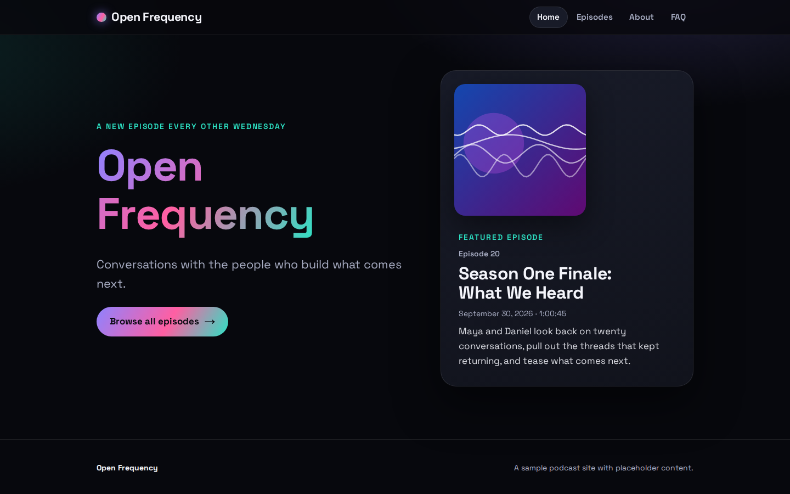
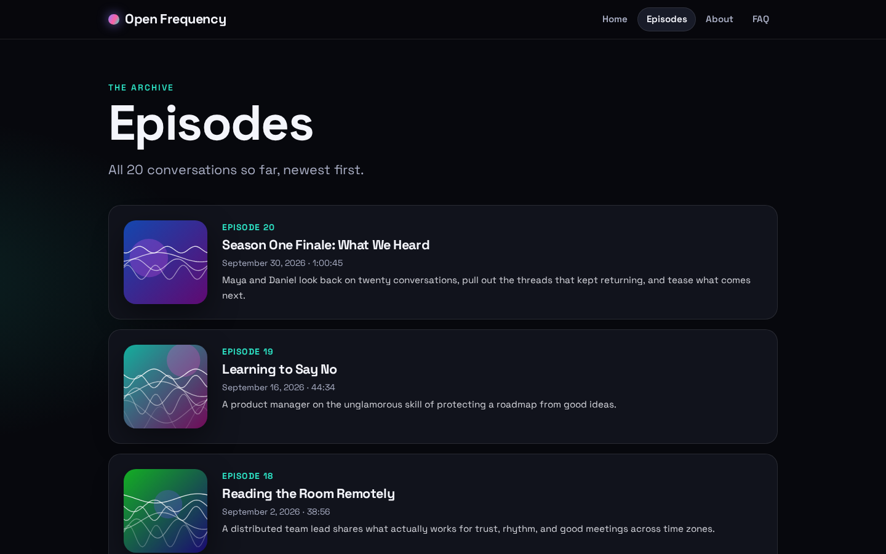
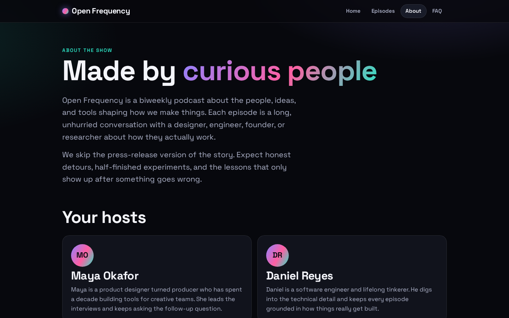
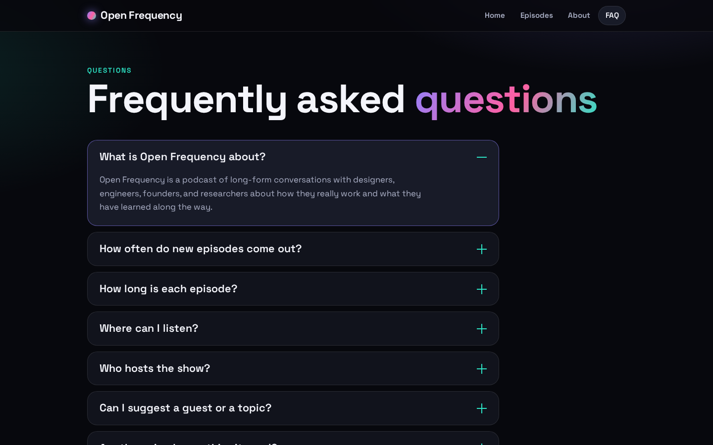
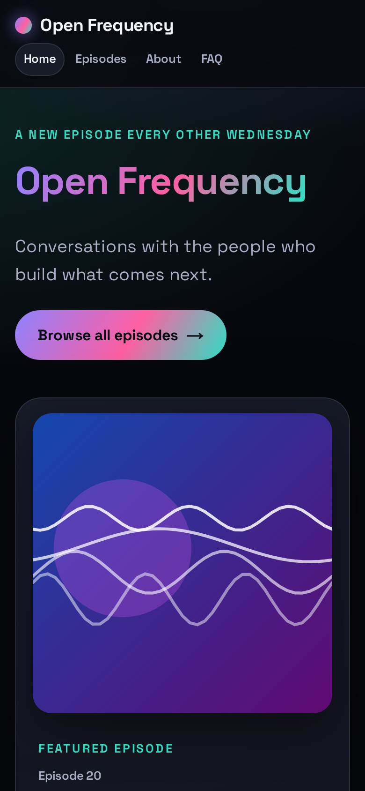
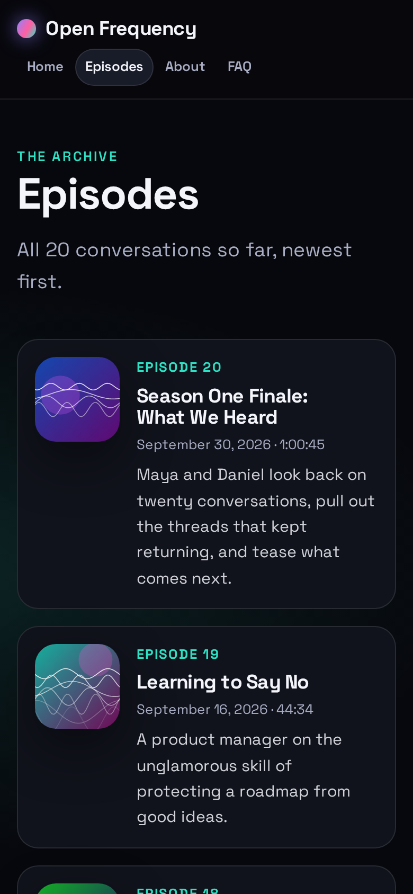

# Open Frequency

### A podcast website, built end to end with Spec Kit

[](https://github.com/github/spec-kit)
[](#what-spec-kit-is)
[](#run-the-site)

> [!IMPORTANT]
> **This repository was built with [Spec Kit](https://github.com/github/spec-kit).**
> Before any code existed, we wrote a project **constitution**, a **specification**, a technical
> **plan**, and a **task list**. The site was then built from those documents, one task at a time.
> Every one of those documents is in this repo, so you can read exactly how a one-line brief became a
> tested website. [Jump to the paper trail](#the-paper-trail).



**Contents:** [At a glance](#spec-kit-at-a-glance) · [Paper trail](#the-paper-trail) ·
[What Spec Kit is](#what-spec-kit-is) · [How we used it](#how-we-used-it) ·
[The result](#the-result) · [Why it belongs in our workflow](#why-we-want-this-in-our-workflow) ·
[Trade-offs](#honest-trade-offs) · [How it is wired in](#how-spec-kit-is-wired-into-this-repo) ·
[Next feature](#using-it-on-the-next-feature) · [Run the site](#run-the-site)

## Spec Kit at a glance

One short brief went in: *a modern, sleek podcast website with a landing page featuring one episode,
plus episodes, about, and FAQ pages, using 20 mocked episodes and no real feed.* This is what the
workflow produced from it.

| Step | Command | What it produced |
|------|---------|------------------|
| 1. Rules | `/speckit-constitution` | **5** governing principles (v1.0.0) |
| 2. What and why | `/speckit-specify` | **4** user stories, **13** requirements, **6** measurable success criteria, **16/16** quality checks |
| 3. How | `/speckit-plan` | **12** recorded technical decisions, a data model, route contracts, a quickstart |
| 4. Work items | `/speckit-tasks` | **37** tasks in 7 phases, each naming its file |
| 5. Build | `/speckit-implement` | **37/37** tasks done, **10** unit and **120** end-to-end tests passing |

## The paper trail

Everything below was generated by Spec Kit and is checked in. Read it in order to follow the whole story.

| Document | What it answers |
|----------|-----------------|
| [`constitution.md`](.specify/memory/constitution.md) | What rules does every decision have to follow? |
| [`spec.md`](specs/001-podcast-website/spec.md) | What are we building, for whom, and how will we know it works? |
| [`checklists/requirements.md`](specs/001-podcast-website/checklists/requirements.md) | Is the spec complete and testable? |
| [`plan.md`](specs/001-podcast-website/plan.md) | What is the technical approach, and does it respect the constitution? |
| [`research.md`](specs/001-podcast-website/research.md) | Why this choice, and what did we reject? |
| [`data-model.md`](specs/001-podcast-website/data-model.md) | What data exists, and what rules does it follow? |
| [`contracts/`](specs/001-podcast-website/contracts/) | What pages and data shapes does the site promise? |
| [`quickstart.md`](specs/001-podcast-website/quickstart.md) | How do we prove the feature works end to end? |
| [`tasks.md`](specs/001-podcast-website/tasks.md) | What was built, in what order? Every box is ticked. |

## What Spec Kit is

[Spec Kit](https://github.com/github/spec-kit) turns a feature request into a chain of written
artifacts, each one feeding the next:

```text
 idea
   │
   ▼
/speckit-constitution   →  project rules that every later step must respect
   │
   ▼
/speckit-specify        →  spec.md        WHAT and WHY (users, requirements, success criteria)
   │   (optional: /speckit-clarify, /speckit-checklist)
   ▼
/speckit-plan           →  plan.md + research, data model, contracts, quickstart   HOW
   │
   ▼
/speckit-tasks          →  tasks.md       ordered, checkable work items
   │   (optional: /speckit-analyze)
   ▼
/speckit-implement      →  code + tests, with tasks ticked off as they finish
```

Each step reads the output of the previous one, so the specification stays the single source of truth
instead of living in someone's head or a chat thread.

## How we used it

### 1. Constitution: the ground rules

`/speckit-constitution` filled the template with the bare minimum for a static web app (version
**1.0.0**). Five principles now govern every later decision:

1. **Static-Only Delivery**: plain static files, no server runtime or database.
2. **Simplicity**: every dependency and build step needs a recorded justification.
3. **Accessibility & Responsiveness**: semantic HTML, keyboard use, works from 320px up.
4. **Performance & Privacy**: no third-party scripts or trackers, usable without JavaScript.
5. **Reproducible Build**: builds from a clean checkout with documented commands.

These were not decoration. The plan checked itself against them, and they directly produced decisions
such as a self-hosted font, CSS-generated cover art instead of image files, and native `<details>`
elements for the FAQ.

### 2. Specify: what and why, with no technology

`/speckit-specify` created [`spec.md`](specs/001-podcast-website/spec.md):

- **4 prioritized user stories** (landing page P1, episodes P2, about P3, FAQ P3), each with an
  independent test and acceptance scenarios.
- **13 functional requirements** and **6 measurable success criteria** (for example, all four pages
  reachable from any page in one action, and no horizontal scroll at 320px).
- **Edge cases** (not-found page, tiny and huge screens, keyboard-only use, reduced motion, very long
  titles).
- **Documented assumptions** for everything the brief left open (no audio playback, no episode detail
  pages, placeholder content).

The spec was validated against a 16-item quality checklist, which passed with no open clarification
markers.

### 3. Plan: how, with decisions on the record

When we said we would use Next.js with static export and embedded data, `/speckit-plan` turned that into:

- [`plan.md`](specs/001-podcast-website/plan.md): technical context, a constitution check (all five
  principles pass), and the project layout.
- [`research.md`](specs/001-podcast-website/research.md): 12 decisions, each with rationale and the
  alternatives rejected (for example, Tailwind and a hamburger menu were considered and left out).
- [`data-model.md`](specs/001-podcast-website/data-model.md): Show, Episode, and FAQ Entry, with
  validation rules such as "exactly 20 episodes, exactly one featured".
- [`contracts/`](specs/001-podcast-website/contracts/): the five routes and what each page must
  contain, plus a JSON Schema for the episode data.
- [`quickstart.md`](specs/001-podcast-website/quickstart.md): the exact commands and expected results to
  validate the feature end to end.

### 4. Tasks: a checklist anyone can pick up

`/speckit-tasks` produced [**37 tasks in 7 phases**](specs/001-podcast-website/tasks.md) (setup,
foundation, one phase per user story, polish). Every task names an exact file path, parallel-safe tasks
are marked `[P]`, and each task is tagged with its user story (`[US1]`-`[US4]`). Data constraints from
the data model were quoted word for word in the tasks so nothing was left to guesswork.

### 5. Implement: build, verify, tick off

`/speckit-implement` worked through the list in order, marking each task `[X]` as it finished.
Test-first was followed per story: the landing page tests were written first and confirmed failing
(4 of 4) before the page existed.

Result: **all 37 tasks complete, 10 unit tests and 120 end-to-end tests passing** from a clean
install, including automated accessibility checks, a 320px no-horizontal-scroll check, and a check
that pages make no requests to other origins.

The process also surfaced real problems early:

- A responsive test caught a very long unbroken word in an episode title forcing the page wider than a
  320px screen. It was fixed in CSS before anyone saw it.
- The planned test runner needed a newer Node version than the one installed. The version was pinned to
  one that works and the change was recorded.

## The result

This is the site that came out of the process above, captured from the built output.

**Landing page**: show identity and the single featured episode, visible without scrolling on desktop.


**Episodes page**: all 20 mock episodes, newest first, each with number, title, date, duration, and
description.



**About page**: the show description and one section per host.



**FAQ page**: native expandable questions that work without JavaScript. The first entry is open here.



**Mobile (390px wide)**: the same pages reflow to one column with the navigation fully visible, which the
spec's 320px requirement and the end-to-end tests enforce.

| Landing page | Episodes page |
|--------------|---------------|
|  |  |

The content in these screenshots is sample data, as the spec requires.

### Traceability in practice

Any part of the site can be traced back to a reason and forward to a check:

| Need | Where it is decided | Where it is verified |
|------|---------------------|----------------------|
| FR-009: content is fixed sample data, no feed | `data-model.md`, task T009, `src/data/episodes.ts` | `tests/unit/data.test.ts` |
| FR-008: FAQ answers readable on demand | `contracts/site-routes.md`, tasks T030-T031 | `tests/e2e/faq.spec.ts` |
| SC-005: keyboard use and no scroll at 320px | Constitution principle III, tasks T033-T034 | `tests/e2e/accessibility.spec.ts`, `tests/e2e/responsive.spec.ts` |

## Why we want this in our workflow

1. **Agreement before code.** The spec and plan are cheap to change; code is not. Disagreements about
   scope show up while they are a one-line edit, not a pull request rewrite.
2. **The reasons are written down.** `research.md` records not just what was chosen but what was
   rejected and why, so nobody has to re-argue "why not Tailwind?" six months later.
3. **Rules that persist.** The constitution carries our standards (accessibility, privacy, simplicity)
   into every feature automatically, rather than relying on each person remembering them.
4. **Requirements you can test.** Specs require measurable success criteria and testable requirements,
   which is what made it straightforward to write the end-to-end tests that now guard the site.
5. **Work that can be split and resumed.** Tasks are small, ordered, tagged by user story, and name their
   files. Several people (or agents) can work in parallel, and anyone can pick up where someone else
   stopped by reading which boxes are ticked.
6. **Independently shippable slices.** Stories are prioritized and independently testable, so the
   landing page alone is a valid first release, and every later story adds value without breaking it.
7. **Consistency with AI assistance.** An AI agent given a precise spec, plan, and task list produces
   work that matches the intent. A vague prompt produces something plausible but different. The
   artifacts keep the assistant on track and make its output reviewable against a written standard.
8. **Easier reviews and onboarding.** A reviewer can compare a change to the spec instead of guessing
   intent. A new teammate can read `specs/` to learn what the system should do and why.
9. **Lower risk of rework.** Edge cases and assumptions are surfaced during specification (for
   example, "no audio playback in v1"), instead of discovered after the build.

## Honest trade-offs

- **Up-front time.** The first run through the artifacts takes longer than just starting to code. It
  pays off most on features with more than one person, more than one story, or a long life.
- **Overkill for tiny changes.** A typo fix or one-line bug fix does not need a spec. Reserve the full
  flow for new features and significant changes.
- **Documents can drift.** If the code changes and the spec does not, the spec becomes misleading.
  `/speckit-analyze` and `/speckit-converge` exist to catch this, and we should run them on larger work.
- **Assumptions need review.** The AI fills gaps with reasonable defaults and lists them under
  "Assumptions". A human still has to read that section and correct anything wrong.

## How Spec Kit is wired into this repo

Spec Kit is installed as a set of Claude Code skills (slash commands) plus a small `.specify/` folder
of templates and scripts.

| Path | What it is |
|------|------------|
| `.claude/skills/speckit-*/` | The slash commands. Each folder defines one command's instructions. |
| `.specify/memory/constitution.md` | The project constitution: principles and governance. |
| `.specify/templates/` | Templates for the spec, plan, tasks, checklists, and constitution. |
| `.specify/scripts/bash/` | Helper scripts the commands call (template resolution, prerequisite checks, setup). |
| `.specify/feature.json` | Points downstream commands at the active feature folder. |
| `.specify/init-options.json` | Install settings (for example, sequential feature numbering). |
| `specs/<NNN>-<feature>/` | One folder per feature holding every artifact for it. |

Optional extension hooks can be registered in `.specify/extensions.yml` to run extra steps before or
after a command. This project does not use any, so every command ran as-is.

### The commands

| Command | Purpose | Produces | Used here? |
|---------|---------|----------|------------|
| `/speckit-constitution` | Create or update the project's governing principles. | `.specify/memory/constitution.md` | Yes |
| `/speckit-specify` | Turn a plain-language feature description into a structured spec with a quality checklist. | `spec.md`, `checklists/requirements.md` | Yes |
| `/speckit-clarify` | Ask up to 5 targeted questions about under-specified areas and write the answers back into the spec. | Updated `spec.md` | Not needed |
| `/speckit-checklist` | Generate a custom requirements-quality checklist (for example UX or security). | `checklists/<name>.md` | Not needed |
| `/speckit-plan` | Choose the technical approach and produce the design documents. | `plan.md`, `research.md`, `data-model.md`, `contracts/`, `quickstart.md` | Yes |
| `/speckit-tasks` | Break the plan into dependency-ordered tasks grouped by user story. | `tasks.md` | Yes |
| `/speckit-analyze` | Read-only consistency check across spec, plan, and tasks. | A report in chat | Optional, not run |
| `/speckit-implement` | Execute the tasks in order and tick each one off. | Source code, tests, updated `tasks.md` | Yes |
| `/speckit-converge` | Compare the codebase to the spec, plan, and tasks, and append any still-unbuilt work as new tasks. | New tasks in `tasks.md` | Not needed |
| `/speckit-taskstoissues` | Convert tasks into GitHub issues. Marked deprecated in this install. | Issues | Not used |

## Using it on the next feature

1. Describe the feature in plain language:
   `/speckit-specify <what you want and why, no tech stack>`
2. (Optional) Tighten ambiguous areas: `/speckit-clarify`
3. Choose the approach: `/speckit-plan <technology and architecture preferences>`
4. Break it down: `/speckit-tasks`
5. (Optional) Cross-check everything: `/speckit-analyze`
6. Build it: `/speckit-implement`

Review the generated documents at each step before moving on; that review is where most of the value is.
Artifacts for each feature accumulate under `specs/`, giving the project a readable history of what was
built and why.

## Run the site

A sleek, static podcast site built with Next.js (App Router, static export). It has a landing page with
one featured episode, an episodes page (20 mock episodes), an about page, and an FAQ page. All content is
sample data embedded in the repo (`src/data/`); there is no database, feed, or server runtime.

**Prerequisites:** Node.js 20 (20.12 or newer) and npm.

```bash
npm ci                              # install exact dependencies from the lockfile
npm run dev                         # local development server
npm run build                       # build the static site into out/
npm run start                       # preview the built out/ directory at http://localhost:3000
npm run test:unit                   # Vitest: data and formatting checks
npx playwright install chromium     # one-time browser download for e2e tests
npm run test:e2e                    # Playwright + axe: run after `npm run build`
```

The `out/` directory can be deployed to any static host.

### Editing content

- Show name, tagline, and hosts: `src/data/show.ts`
- Episodes (exactly 20, one `featured`): `src/data/episodes.ts`
- FAQ entries: `src/data/faq.ts`

Run `npm run test:unit` after editing; it enforces the data rules (20 episodes, unique numbers, exactly
one featured, newest has the latest date).

---

<p align="center">
  <strong>Specified, planned, tasked, and built with <a href="https://github.com/github/spec-kit">Spec Kit</a>.</strong>
</p>
